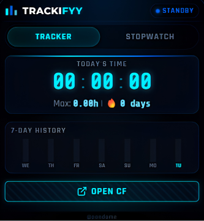
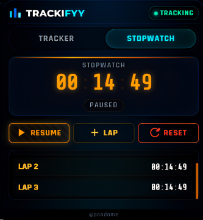

# Trackifyy 🚀

### Codeforces Practice Time Tracker

<p align="center">
  
</p>

<p align="center">
  <strong>Know exactly how much time you spend solving problems on Codeforces.</strong><br/>
  A cyber-neon Chrome extension that tracks your practice hours, streaks, and problem-solving speed.
</p>

<p align="center">
  
  
</p>

---

## 🌟 About

Consistency wins in competitive programming, but it's hard to improve what you don't measure. **Trackifyy** quietly logs the time you actively spend on Codeforces, then shows it in a glowing neon dashboard with a 7-day chart, streak counter, and a built-in stopwatch for timing individual problems.

No accounts, no sign-ups, no servers. Everything stays in your browser.

## 📸 Screenshots

<p align="center">
  
  &nbsp;&nbsp;&nbsp;&nbsp;
  
</p>

---

## ✨ Features

### 🕒 Automatic Time Tracking
- **Active-tab only:** counts only the seconds you spend on a focused Codeforces tab, so idle background tabs don't inflate your numbers.
- **Digital clock display:** today's total practice time in a bold, glowing readout.
- **Streaks 🔥:** see how many days in a row you've practiced, plus your all-time daily record.
- **7-day chart:** a lightweight, pure-CSS bar chart of your practice trend over the past week.

### ⏱️ Stopwatch & Laps
- **Time a single problem** or simulate a contest round.
- **Start, pause, and reset** with smooth glow-button interactions.
- **Lap splits:** mark stages like understanding, coding, and debugging.
- **Scrollable lap history** right inside the popup.

### 🎨 Neon Design
- Glassmorphism panels, HSL-based glows, and soft drop-shadow animations.
- Smooth transitions between the Tracker and Stopwatch views.
- Hover effects and visual feedback on every control.

---

## 🛠️ Installation

Trackifyy isn't on the Chrome Web Store yet, so you load it manually in a few steps:

1. **Clone the repository**
   ```bash
   git clone https://github.com/samiya-akhter/Trackifyy.git
   ```

2. **Open the extensions page**
   Go to `chrome://extensions/` in Chrome (or use the menu: **Extensions → Manage Extensions**).

3. **Turn on Developer mode**
   Use the toggle in the top-right corner.

4. **Load the extension**
   Click **Load unpacked** and select the **`Trackifyy`** subfolder (the one containing `manifest.json`).

5. **Pin it**
   Click the puzzle-piece icon in the toolbar, then pin **Trackifyy** for quick access.

Now open any Codeforces page and start solving. Tracking begins automatically.

---

## 🔒 Privacy

Trackifyy stores all data locally using `chrome.storage.local`. Nothing is sent to any server, and tracking only happens on Codeforces pages.

---

## 📂 Project Structure

```text
Trackifyy/
├── Trackifyy/              # Extension source (load this folder in Chrome)
│   ├── manifest.json       # Manifest V3 configuration
│   ├── background.js       # Service worker: tab monitoring and tracking state
│   ├── content.js          # Content script: activity heartbeat on Codeforces pages
│   ├── popup.html          # Popup markup (Tracker and Stopwatch panels)
│   ├── popup.css           # Cyber-neon styles, variables, and animations
│   ├── popup.js            # Chart rendering, stopwatch logic, and UI state
│   ├── logo.png            # Main logo
│   └── icon16/32/48/128.png
├── screenshots/            # README preview images
├── .gitignore
└── README.md
```

---

## ⚙️ How It Works

| Component | Role |
|---|---|
| **`background.js`** (service worker) | Listens to tab events, checks whether the active tab is on Codeforces, and periodically updates stored totals. |
| **`content.js`** (content script) | Runs on Codeforces pages and sends activity and heartbeat signals so only real, focused time is counted. |
| **`chrome.storage.local`** | Saves daily practice seconds, 7-day history, streak and peak records, and stopwatch laps. |
| **`popup.css`** | Hand-written vanilla CSS using custom properties, flexbox, and HSL colors for the neon look. |

---

## 🤝 Contributing

Ideas, bug reports, and pull requests are welcome.

1. Fork the repo
2. Create a branch: `git checkout -b feature/your-idea`
3. Commit your changes and push the branch
4. Open a pull request

You can also open an [issue](https://github.com/samiya-akhter/Trackifyy/issues) to suggest a feature or report a problem.

---

<p align="center">
  <em>Made with</em> 🩵 <em>for competitive programmers by <a href="https://github.com/samiya-akhter">@samiya-akhter</a></em>
</p>
